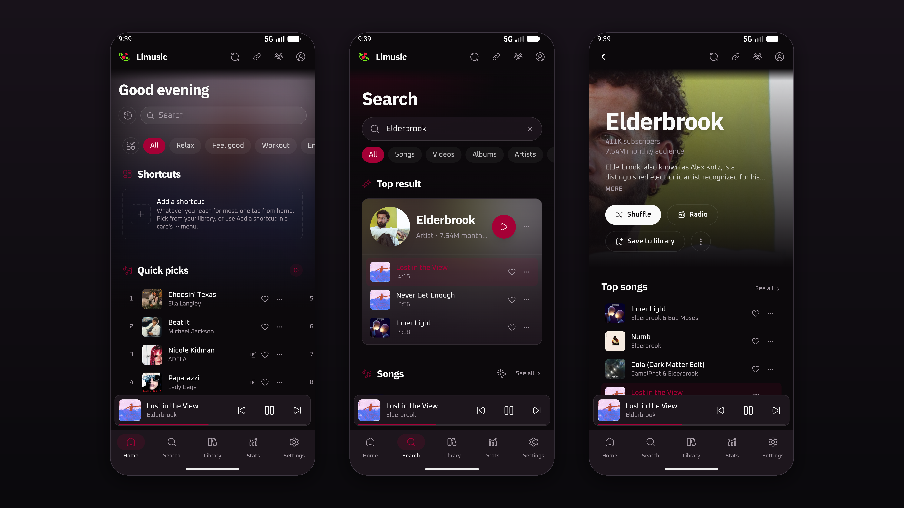
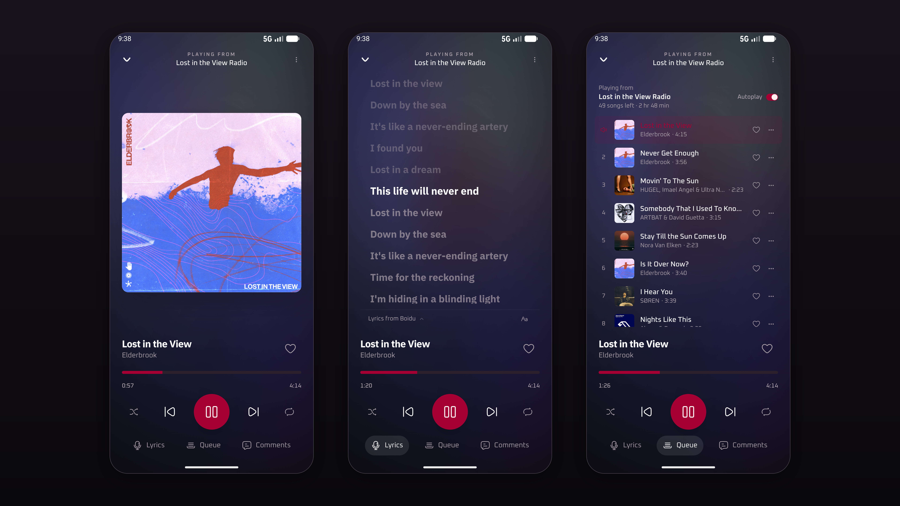
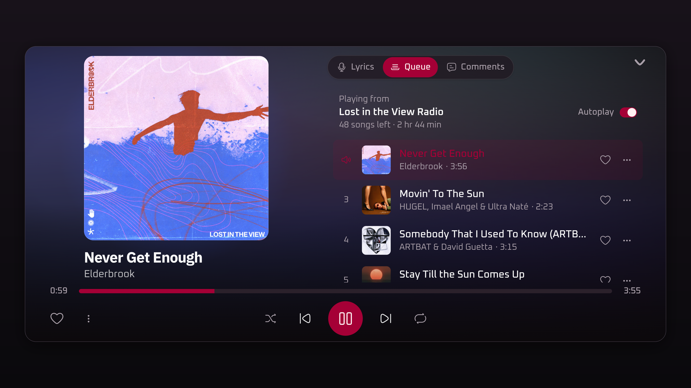
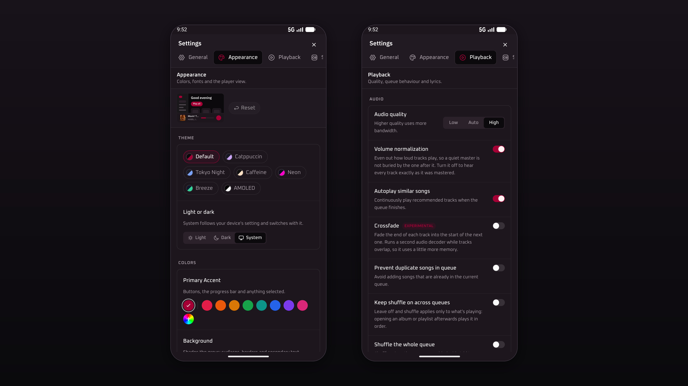

<div align="center">
  

  <h1>Limusic for Android</h1>

  <p>
    An unofficial Android port of
    <a href="https://github.com/SimoHypers/limusic">Limusic</a>,
    the YouTube Music client by SimoHypers.
  </p>

  <h2><a href="https://github.com/vajoexe/limusic-android/releases">Download</a></h2>
</div>

> **NOTICE:** Limusic needs Android System WebView **111 or newer**. With an older one the app shows a notice instead of a broken screen, and opens normally once WebView is updated. Reported issues about rendering on an outdated WebView will be ignored and closed.
>
> [How to update WebView](https://support.google.com/android/thread/103561027/an-update-regarding-app-crashes-and-system-webview?hl=en)

This is the desktop app's code running on a phone. The Rust core, the SvelteKit
interface and the libmpv playback engine are the same ones the desktop app uses.
The port adds a phone layout, a media notification, Android sign-in and the
platform glue needed for all of that to work. Wherever it could, it changes how
the app looks and leaves how it works alone.

It is a community port. It is not an official Limusic release, and the Limusic
developers do not support it. Please don't report problems with this port in
the upstream repository.

<table>
  <tr>
    <td></td>
  </tr>
  <tr>
    <td></td>
  </tr>
  <tr>
    <td></td>
  </tr>
  <tr>
    <td></td>
  </tr>
</table>

## Status

Everything below has been tested on multiple Android VMs with multiple Android versions, and a Samsung S24 FE. Provided a semi-recent enough version of Android and WebView, everything *should* work.

What works:

- Home feed, search, artists, albums and playlists
- Playback in the background and with the screen off, with the media
  notification and media keys, lock screen controls and Bluetooth buttons
- The queue, shuffle, repeat and autoplay radio
- Synced lyrics, line by line and word by word
- Music videos, with ambient light behind them, and a fallback to audio if a
  video won't load
- Song comments: reading, liking, replying and posting
- Signing in with Google's own sign-in page, several accounts at once, and
  pasting cookies as a fallback
- Your library: likes, playlists, saved albums and artists
- Local music from a folder you pick
- Portrait and landscape, with a wider layout for tablets and desktop windows
- Samsung DeX (tested on a Galaxy S24 FE). Enable fullscreen for the app from the status bar to make theater mode fill the entire display.

What doesn't work, or works differently:

- **Speed, pitch and reverb** are missing. The prebuilt libmpv this port uses
  leaves out the audio filters they need.
- **Loudness normalization** only turns loud tracks down. Quiet tracks stay as
  they are, and there is no limiter. The desktop version does real
  normalization, so this is a weaker substitute.
- **Discord Rich Presence** is turned off. The Discord app for Android has no
  way for another app to set your status. The only workaround uses your Discord
  login token, which breaks Discord's terms, so this port doesn't use it.
- **Sign-in** happens on Google's web sign-in page inside the app. Android's
  account picker can't be used, because it gives out a different kind of login
  than the one YouTube Music's web API accepts. If Google ever blocks the page,
  pasting cookies still works.
- **Tray, mini player window, global hotkeys, start on login and the
  self-updater** are desktop features with no Android equivalent.
- If Android kills the app in the background, the notification can't restart
  playback yet. Open the app again instead.

## Install

Download the APK from [Releases](https://github.com/vajoexe/limusic-android/releases)
and open it on your phone. Android will ask you to allow installs from your browser
or file manager the first time.

You need Android 8.0 or newer and Android System WebView 111 or newer. The APK
is universal: it runs natively on 64-bit ARM (`arm64-v8a`) phones and tablets
and on 64-bit x86 (`x86_64`) devices such as emulators and some Chromebooks.

### Why WebView 111

The interface is a web page drawn by Android System WebView. Its colours are
CSS `oklch()` colours and its scripts are built for Chromium 111, so an older
WebView loses most colours and much of the layout. On startup the app checks
which WebView is installed. If it is older than 111, the app shows a full-screen
notice with a link to the Play Store and to
[Google's instructions](https://support.google.com/android/thread/103561027/an-update-regarding-app-crashes-and-system-webview?hl=en).
If the version can't be read, the app starts normally rather than guessing. To
update, install the latest **Android System WebView** (or Chrome, on Android
versions that use it as the WebView) from the Play Store, then reopen Limusic.

Every release is signed with the same key. Its SHA-256 certificate fingerprint is:

```
EB:14:47:0C:C1:AD:37:7A:52:6A:93:F8:75:E4:1C:16:6E:61:D0:3D:53:9B:54:61:3F:39:BE:BB:55:F7:E8:85
```

You can check a download with `apksigner verify --print-certs limusic-*.apk`. If the
fingerprint is different, the APK did not come from this repository.

## Building

You'll need:

- The Android SDK with `platforms;android-37.0`, `build-tools;37.0.0`,
  `ndk;28.2.13676358` and `platform-tools`
- JDK 17
- Rust with the `aarch64-linux-android` and `x86_64-linux-android` targets
- The Tauri CLI: `cargo install tauri-cli --version '^2'`
- Node.js and pnpm 10

Then:

```sh
export ANDROID_HOME=/path/to/android-sdk
source scripts/android/env.sh          # sets up the NDK, bindgen and JAVA_HOME
scripts/android/fetch-libmpv.sh        # downloads libmpv, checks its SHA-256
(cd ui && pnpm install --frozen-lockfile)

# Debug build for the emulator
cargo tauri android build --debug --target x86_64 --apk

# Debug build for both architectures, like the release
cargo tauri android build --debug --target aarch64 --target x86_64 --apk

# Signed release build for phones (see Release signing below)
scripts/android/build-release.sh
```

The APKs end up in `src-tauri/gen/android/app/build/outputs/apk/`.
`build-release.sh` builds one universal APK with both `arm64-v8a` and `x86_64`
libraries and lists the libraries it packed, per architecture, after signing.
A release build made with plain `cargo tauri android build --apk`, with no
signing key set up, comes out unsigned.

Debug builds are big because the Rust library keeps its debug symbols: about
500 MB for one architecture and 1.5 GB for both. Release builds are much
smaller; the universal one is larger than a single-architecture build because
it carries both sets of libraries.

### Release signing

Release APKs are signed with a self-signed certificate, which is how Android
apps outside the Play Store are normally signed. The certificate shows which key
signed the app. It says nothing about Google having checked the publisher.
Releases of this port are signed with the `vajoexe` key. Builds you make
yourself will carry your own key.

Android only installs an update over an existing app when both are signed with
the same key. So every release has to be signed with the same private key, for
as long as the app exists. If the key is lost, people have to uninstall the app,
and lose its data, before they can install a build signed with a new key.

To set up a key, once:

```sh
scripts/android/make-release-key.sh
```

It asks for a password and creates `~/.local/share/limusic/release.jks`, an RSA
4096 key valid for 50 years. It also writes
`src-tauri/gen/android/keystore.properties`, which holds only the keystore path
and the key alias. If a keystore already exists there, the script stops instead
of replacing it. `LIMUSIC_RELEASE_KEYSTORE`, `LIMUSIC_RELEASE_ALIAS` and
`LIMUSIC_RELEASE_DNAME` change the defaults.

To build a signed release:

```sh
scripts/android/build-release.sh
```

It asks for the keystore password, passes it to Gradle through the environment
for that one build, and checks the result with `apksigner`. The password is not
written to any file. In CI, set `LIMUSIC_ANDROID_STORE_FILE`,
`LIMUSIC_ANDROID_KEY_ALIAS`, `LIMUSIC_ANDROID_STORE_PASSWORD` and
`LIMUSIC_ANDROID_KEY_PASSWORD` from the CI's secret store instead.

Keep the keystore out of the repository. `*.jks`, `*.keystore`, `*.p12` and
`keystore.properties` are gitignored as a safety net. Back up the keystore and
its password somewhere other than the build machine: for example the `.jks` file
attached to an entry in an encrypted password manager, plus an offline copy on
a USB drive kept apart from the password.

Last.fm scrobbling needs your own API key, the same as the desktop app. Put it
in `src-tauri/lastfm.keys`:

```
LIMUSIC_LASTFM_API_KEY=your_key
LIMUSIC_LASTFM_API_SECRET=your_secret
```

The desktop build is unchanged. See [docs/BUILD-PLATFORMS.md](docs/BUILD-PLATFORMS.md)
and the [upstream README](https://github.com/SimoHypers/limusic#readme) for
Linux, Windows and macOS.

## Credits

Limusic was created by [SimoHypers](https://github.com/SimoHypers) and the
Limusic contributors. Nearly all of this app is their work. This port only adds
the Android pieces.

If you'd like to support the original developers, you can do so at
[ko-fi.com/simohypers](https://ko-fi.com/simohypers). That money goes to them,
not to this port.

Playback uses [mpv](https://mpv.io) and [FFmpeg](https://ffmpeg.org), packaged
for Android by [libmpv-android](https://github.com/jarnedemeulemeester/libmpv-android).
[THIRD_PARTY_NOTICES.md](THIRD_PARTY_NOTICES.md) lists everything that ships
inside the APK.

## License

GPL-3.0-or-later, the same as Limusic. See [LICENSE](LICENSE). The changes made
for this port are described in [NOTICE](NOTICE).

The APK includes a GPL build of FFmpeg, which is why the app as a whole is
distributed under GPL version 3. Anyone who distributes the APK has to make the
matching source code available too. This repository is that source for the app.
[THIRD_PARTY_NOTICES.md](THIRD_PARTY_NOTICES.md) has links to the source of
the bundled libraries.

## Disclaimer

This project is not affiliated with, funded, authorized or endorsed by YouTube,
Google LLC or any of their affiliates. It is also not an official release from
the Limusic project. All trademarks belong to their respective owners.
